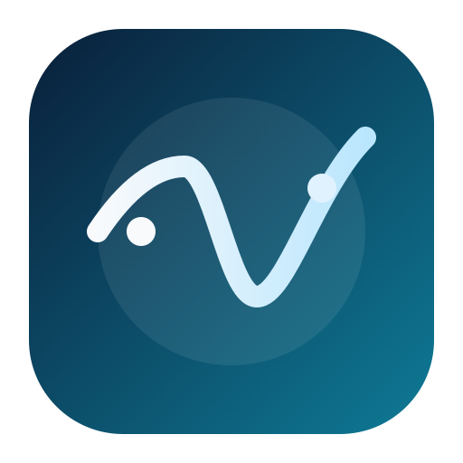
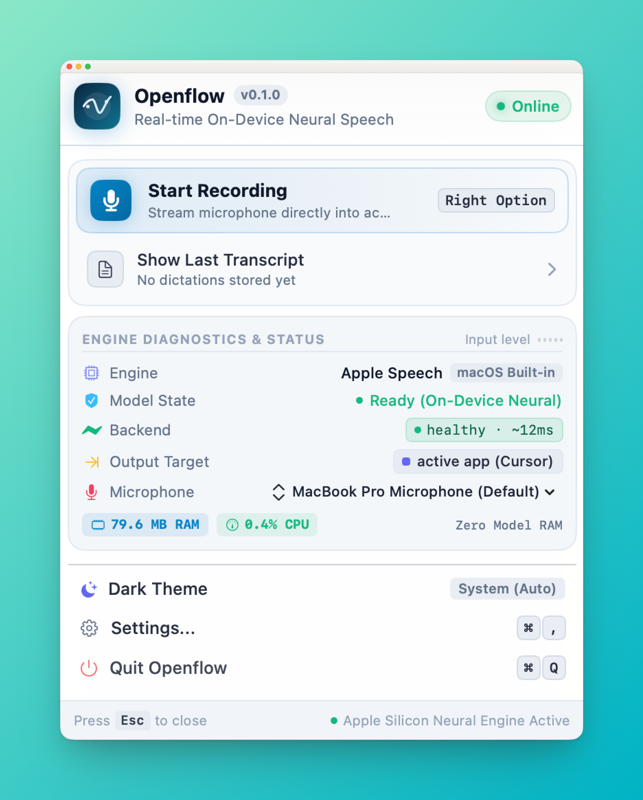
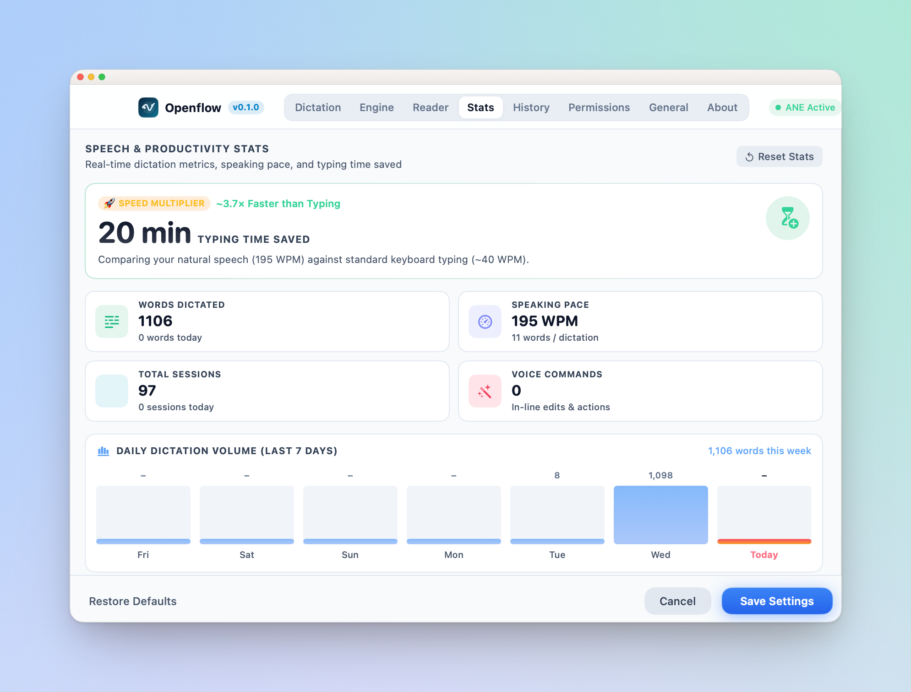
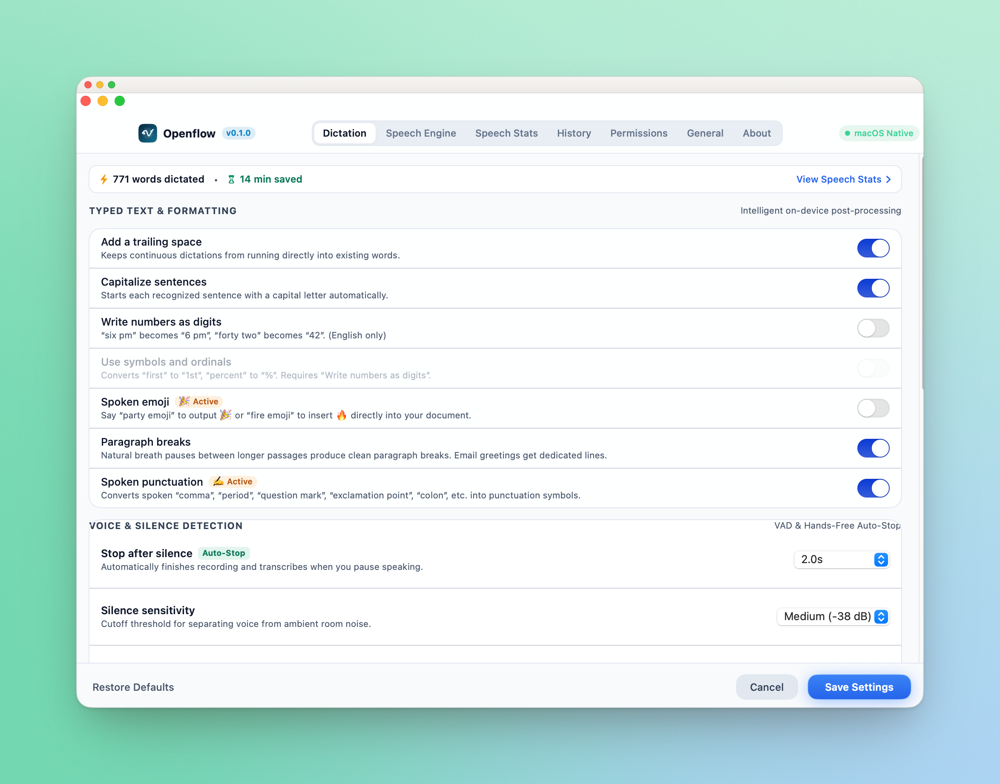
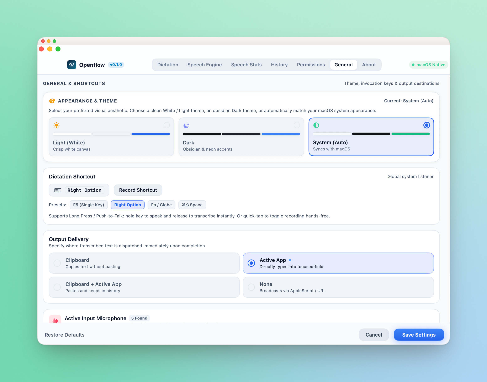

<p align="center">
  
</p>

<h1 align="center">Openflow</h1>

<p align="center">
  <strong>Supercharged, local-first voice dictation and intelligent speech actions for macOS.</strong>
</p>

<p align="center">
  <a href="https://abhilashpanda04.github.io/Openflow/"></a>
  <a href="https://github.com/abhilashpanda04/Openflow/releases/latest"></a>
  <a href="https://github.com/abhilashpanda04/Openflow/actions/workflows/ci.yml"></a>
  
  
  
  
  
</p>

<p align="center">
  <a href="https://abhilashpanda04.github.io/Openflow/">🌐 <strong>Live Website</strong></a> •
  <a href="#-quick-start">Quick Start</a> •
  <a href="#-screenshots--interface">Screenshots</a> •
  <a href="#-key-features">Key Features</a> •
  <a href="#-asr-engines">ASR Engines</a> •
  <a href="#-voice-commands--shortcuts">Voice Commands</a> •
  <a href="#-developer-guide">Developer Guide</a> •
  <a href="#-privacy--security">Privacy</a>
</p>

---

<p align="center">
  
</p>

---

## ⚡ Overview

**Openflow** is a native macOS menu bar dictation companion engineered for zero-friction voice-to-text. Press your global shortcut, speak naturally, and watch your voice transform into formatted text pasted directly into whatever application you are using.

Powered by **WhisperKit CoreML** and **Apple Speech**, Openflow runs completely on-device with zero telemetry, zero cloud dependencies, and immediate responsiveness.

---

## ✨ Key Features

### 🚀 On-Device Neural ASR (WhisperKit)
- **Local Apple Silicon Execution:** Transcribe speech on the Neural Engine (ANE) and GPU via [WhisperKit](https://github.com/argmaxinc/WhisperKit). No Python, no Docker, and no cloud latency.
- **Model Flexibility:** Choose from Whisper Tiny, Base, Small, Medium, Large-v3, or Turbo models based on your memory and accuracy preferences.
- **Native Apple Speech Support:** Switch effortlessly to macOS's built-in `SFSpeechRecognizer` with real-time on-device punctuation on macOS 14+.

### 🧠 Voice Commands & Apple Intelligence
- **In-Line Voice Actions:** Speak commands seamlessly within dictation:
  - `"scratch that"` — instantly discards dictation and plays a cancel cue.
  - `"select all"`, `"copy"`, `"paste"`, `"undo"`, `"redo"`, `"delete line"`.
  - `"new line"`, `"new paragraph"`.
- **In-Line Case Formatting:** Say `"urgent all caps that"` or `"make that uppercase"` to dynamically format preceding words.
- **Apple Intelligence Integration:** Trigger native macOS Writing Tools (`AXShowWritingTools`), proofreading, rewriting (Professional, Friendly, Concise), and summarization directly via voice.

### 🤫 Smart VAD & Silence Trimming
- **Automatic Silence Trimming:** Strips leading/trailing dead air before transcription, eliminating hallucinations and speeding up processing.
- **Voice Activity Auto-Stop:** Automatically stops and transcribes when you pause speaking (configurable from 1 to 5 seconds).
- **Max Duration Limit:** Configurable safety limit to prevent accidental run-away recordings.

### 🔔 Native Audio Feedback Cues
- Plays Apple's native Siri dictation chimes asynchronously when recording starts (`jbl_begin.caf`), completes (`jbl_confirm.caf`), or cancels (`jbl_cancel.caf`).
- Completely asynchronous to ensure zero impact on microphone latency.

### 🎨 Chromatic HUD & Dual Theme UI
- **Live Chromatic Visualizer:** 36-color harmonic voice spectrum equalizer during recording and transcription.
- **Customizable Overlay Placement:** Float the dictation HUD at the top or bottom of your screen.
- **Dark & Light Mode:** Thoughtfully designed UI that seamlessly adapts to your preferred macOS appearance.
- **Speech Analytics & History:** Monitor words dictated, estimated minutes saved, active RAM/CPU footprint, and past transcripts.

---

## 📸 Screenshots & Interface

<table>
  <tr>
    <td width="50%" align="center">
      <strong>Productivity & Speed Analytics</strong><br/><br/>
      <a href="screenshot/productivity-stats.png">
        
      </a>
      <p align="left"><em>Real-time metrics tracking words dictated, typing time saved, speaking pace (WPM), active workflow applications, and engine distribution.</em></p>
    </td>
    <td width="50%" align="center">
      <strong>Dictation & Formatting Control</strong><br/><br/>
      <a href="screenshot/dictation-settings.png">
        
      </a>
      <p align="left"><em>Intelligent post-processing: spoken emoji, spoken punctuation, trailing space handling, sentence capitalization, and configurable VAD auto-stop silence thresholds.</em></p>
    </td>
  </tr>
  <tr>
    <td width="50%" align="center">
      <strong>Appearance & Shortcuts</strong><br/><br/>
      <a href="screenshot/general-settings.png">
        
      </a>
      <p align="left"><em>Dual theme support (Light, Dark, System Auto), single-key activation presets (Right Option, F5, Fn/Globe), and direct-to-app or clipboard output routing.</em></p>
    </td>
    <td width="50%" align="center">
      <strong>Menu Bar Diagnostics & Hero Controls</strong><br/><br/>
      <a href="screenshot/menubar-popover.png">
        
      </a>
      <p align="left"><em>Compact menu bar popover with real-time engine diagnostics, microphone level indicators, instant recording toggle, and hardware footprint monitoring.</em></p>
    </td>
  </tr>
</table>

---

## 🎙 ASR Engines

Openflow lets you switch between three distinct speech recognition backends:

| Engine | Type | Network | Privacy | Accuracy | Best For |
| :--- | :--- | :--- | :--- | :--- | :--- |
| **WhisperKit CoreML** *(Default)* | On-Device Neural Engine | None | 100% Offline | Extremely High | Daily private dictation on M1/M2/M3/M4 Macs |
| **Apple Speech** | Native macOS Framework | Optional | High | High | Instant start-up, zero model downloads |
| **Remote Server** | HTTP ASR Endpoint | LAN / WAN | Configurable | Model-dependent | Shared GPU clusters or self-hosted Qwen/Whisper |

---

## ⚡ Voice Commands & Shortcuts

While speaking, Openflow recognizes contextual voice commands and executes system shortcuts on the frontmost application:

| Spoken Phrase | Action Triggered |
| :--- | :--- |
| `"scratch that"` / `"cancel dictation"` | Immediately cancels recording, plays cancel chime, and discards audio |
| `"... all caps that"` / `"... uppercase that"` | Converts preceding phrase into uppercase (e.g. `URGENT`) |
| `"select all"` | Dispatches `⌘A` to the frontmost application |
| `"copy"` / `"paste"` / `"cut"` | Dispatches `⌘C`, `⌘V`, or `⌘X` |
| `"undo"` / `"redo"` | Dispatches `⌘Z` or `⇧⌘Z` |
| `"delete line"` | Deletes current text line (`⌘⌫`) |
| `"new line"` / `"new paragraph"` | Inserts return keystrokes with balanced hold timing |
| `"writing tools"` / `"proofread that"` | Activates macOS 15.1+ Apple Intelligence Writing Tools |

---

## 📦 Quick Start

### 1. Download the App
Download the latest `Openflow.dmg` from [**GitHub Releases**](https://github.com/abhilashpanda04/Openflow/releases/latest).

1. Open `Openflow.dmg`.
2. Drag **Openflow.app** into your **Applications** folder.
3. Launch Openflow from Applications or Spotlight.
4. Grant **Microphone** and **Accessibility** permissions when prompted.

### 2. Dictate Anywhere
- Press <kbd>Cmd</kbd> + <kbd>Shift</kbd> + <kbd>Space</kbd> (or your custom single-key hotkey like <kbd>Fn</kbd> or <kbd>Right Option</kbd>).
- Speak naturally.
- The transcribed, formatted text is automatically pasted into your active application.

---

## 🛠 Developer Guide

### Prerequisites
- macOS 14.0 or later
- Xcode 15+ or Swift 5.9+ toolchain
- Apple Silicon Mac (M1/M2/M3/M4 recommended)

### Build & Run
```bash
# Clone the repository
git clone https://github.com/abhilashpanda04/Openflow.git
cd openflow

# Build and run local debug bundle
make debug
open .build/arm64-apple-macosx/debug/Openflow.app

# Run the complete test suite (115 tests)
swift test

# Build production DMG package
make dmg
```

### Makefile Targets
```text
  make debug          # Build debug .app bundle for local testing
  make release        # Build optimized production .app bundle
  make dmg            # Create standalone distributable DMG
  make test-mic       # Launch app to test microphone permission flows
  make clean          # Clean build directories and artifacts
```

---

## 🔒 Privacy & Security

- **Zero Cloud Ingestion:** By default, Openflow performs all audio processing and ASR inference entirely on your local Mac using Apple Silicon CoreML.
- **Automatic Audio Sanitization:** Temporary recording files created during dictation are immediately and securely removed from disk (`/tmp`) upon transcription completion or cancellation.
- **Sandbox & Entitlements:** Minimal, explicit entitlements configured for audio recording and accessibility event dispatch.

---

## 📄 License

This project is licensed under the **Apache License 2.0**. See the [LICENSE](LICENSE) file for details.
